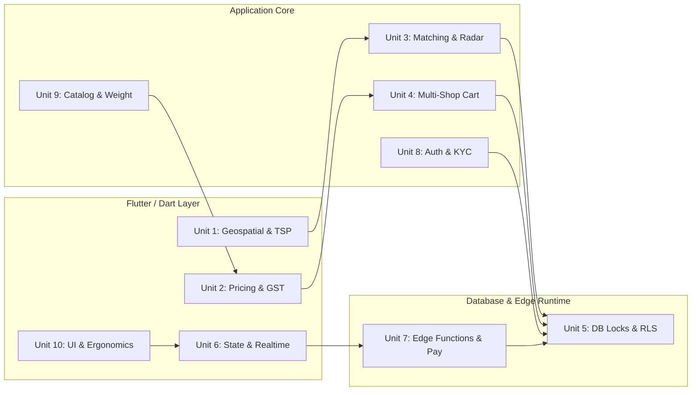

# 100x Forensic Testing Architecture & Execution Master Plan
## Hyperlocal Multi-Role Quick-Commerce Platform (Enything)

---

## Executive Summary & System Profile

This document outlines the master architectural testing blueprint for **Enything**, an enterprise-grade hyperlocal delivery and multi-shop quick-commerce application. The platform coordinates a 4-sided ecosystem (Customers, Merchants, Couriers, and Operations Dispatchers) on a **100% Prepaid Model (Zero Cash on Delivery)**.

```
                              ┌────────────────────────────────────────┐
                              │            Enything System             │
                              └──────────────────┬─────────────────────┘
                                                 │
            ┌─────────────────────┬──────────────┴───────┬─────────────────────┐
            ▼                     ▼                      ▼                     ▼
┌───────────────────────┐ ┌───────────────┐ ┌─────────────────────────┐ ┌───────────────┐
│     Customer App      │ │  Seller App   │ │    Rider Dashboard      │ │ Dispatch Hub  │
│ Multi-Shop Discovery, │ │ Kitchen Queue,│ │ Multi-Stop TSP Routing,  │ │ Radar Radius, │
│ Cart, 100% Prepaid    │ │ Prep Stepper, │ │ Prepaid (₹0 to Collect),│ │ Proxy Accept, │
│ Tracking & Feedback   │ │ KYC & Orders  │ │ Max-3 Hoarding Limit    │ │ Fleet Monitor │
└───────────┬───────────┘ └───────┬───────┘ └────────────┬────────────┘ └───────┬───────┘
            │                     │                      │                      │
            └─────────────────────┴──────────────┬───────┴──────────────────────┘
                                                 ▼
                              ┌────────────────────────────────────────┐
                              │      PostgreSQL 15+ & Supabase         │
                              │ PostGIS Spacing, pg_advisory_xact_lock,│
                              │ 556 Migrations, RLS, Edge Functions    │
                              └────────────────────────────────────────┘
```

---

## 1. Technical Stack & Architecture Inventory

| Layer | Technology | Primary Dependencies / Assets | Role in Hyperlocal Lifecycle |
| :--- | :--- | :--- | :--- |
| **Mobile Client** | Dart 3.x / Flutter | `provider`, `latlong2`, `geolocator`, `flutter_map`, `razorpay_flutter`, `firebase_messaging`, `flutter_background_service`, `audioplayers`, `wakelock_plus` | Multi-role responsive mobile UI, client-side routing, live tracking, background location stream, audio alerts. |
| **Database & RPC** | PostgreSQL 15+ / PostGIS | Supabase managed, 556 migration files, PL/pgSQL stored procedures, triggers, `pg_advisory_xact_lock` | Atomic order matching, state transitions, RLS multi-tenant security, PostGIS spatial queries, immutable audit logging. |
| **Serverless Edge** | TypeScript / Deno | Supabase Edge Functions (`create-razorpay-order`, `verify-razorpay-payment`, `razorpay-webhook`, `process-refund`, `send-push`, `send-otp`) | Server-side Razorpay order generation, HMAC SHA-256 signature verification, FCM v1 notification dispatch, SMS OTP. |
| **Automation & Tooling** | Python 3.x | `.venv`, `requests`, `pillow`, vision AI models, `tools/simulator` | Supermarket catalog batch ingestion, Bandipora multi-shop GPS simulator. |
| **Existing Tests** | Dart / SQL | `test/` (90+ scripts), `supabase/verify_*.sql` (18 scripts) | Disparate regression scripts, unit tests, and live Supabase end-to-end integration scripts. |

---

## 2. The 10 Isolated Testing Units



---

### Unit 1: Geospatial, Geofencing & Multi-Stop TSP Routing Engine
* **Target Modules**: `lib/utils/geo_utils.dart`, `lib/utils/delivery_calculator.dart`, `lib/providers/location_provider.dart`, PostGIS RPCs (`get_nearby_shops`, `get_nearby_unassigned_orders`, `admin_get_dispatch_feed`).
* **Domain Responsibilities**:
  1. Geodesic distance (Haversine formula vs. road network approximation).
  2. Strict 15 km delivery radius enforcement (`maxRadiusKm = 15.0`).
  3. Proximity matching (200m auto-detection of saved addresses).
  4. Realtime heading / compass bearing calculations ($0^\circ \le \theta < 360^\circ$).
  5. Shortest-path angular interpolation across the $0^\circ/360^\circ$ boundary (`lerpAngle`).
  6. Coordinate linear interpolation (`lerpLatLng`) for smooth rider map animation.
  7. Precedence-Constrained Greedy TSP: All physical shops must be visited for pickups before sequencing customer drop-offs.
  8. Waypoint sanitization: Clustering and deduplicating coordinates within 5 meters, capping external navigation URLs to 8 stops.

---

### Unit 2: Dynamic Pricing, GST Compliance, Surcharges & Financial Math Engine
* **Target Modules**: `lib/utils/delivery_calculator.dart`, `lib/config/payment_config.dart`, `lib/config/tax_config.dart`, `lib/services/gst_recommendation_engine.dart`, `lib/utils/weight_engine.dart`, `lib/providers/cart_provider.dart`, `lib/providers/coupon_provider.dart`.
* **Domain Responsibilities**:
  1. Base delivery fee floor (₹20 flat minimum).
  2. Tiered per-km dynamic delivery fee: $\max(\text{flatFee}, \lceil \text{distanceKm} \rceil \times \text{ratePerKm})$.
  3. Multi-shop surcharge: ₹20 per additional shop, calculated by nearest-neighbor distance chain.
  4. Small cart fee: ₹25 penalty on orders with subtotal below ₹199.
  5. Heavy order fee: ₹10/kg for every kg exceeding the 10 kg threshold.
  6. Platform / handling fee: ₹2 flat (with 18% embedded GST extracted for tax reporting).
  7. India GST engine across 34 categories: Section 9(5) deemed ECO supplier rules for restaurants (5% deposited by platform) vs. grocery/retail pass-through.
  8. Razorpay 2.36% gateway fee absorption and proportional seller deduction.
  9. Absolute IEEE-754 floating point precision defense: Sub-paise truncation and exact integer paise conversion ($\text{paise} = \text{round}(\text{amount} \times 100)$).

---

### Unit 3: Hyperlocal Order Matching, Dispatch Radar & Capacity Ceiling Engine
* **Target Modules**: `lib/pages/admin/modules/dispatch_admin_page.dart`, `lib/services/admin_dispatch_settings_service.dart`, `lib/pages/delivery/dashboard_page.dart`, `lib/models/order_group.dart`, migrations `20290000000139`, `20290000000177`.
* **Domain Responsibilities**:
  1. Radar distance filtering: Radius querying of unassigned orders around rider or dispatcher GPS.
  2. Courier capacity ceiling: Strict enforcement of maximum 3 active cart groups per courier.
  3. Admin proxy bypass: Super admins and dispatchers with `dispatch.proxy_rider_accept` bypassing the 3-order cap.
  4. Admin self-delivery mode: Automatic self-healing provisioning of a verified delivery partner record when an admin clicks "Deliver by Myself".
  5. Courier drop order flow: Re-pooling dropped orders and suppressing payment push notifications if payment is already captured.
  6. Sibling shop notifications: Notifying all distinct stores in a cart group when a courier drops an order.

---

### Unit 4: Multi-Shop Cart Aggregation, Sibling Orders & State Machine Fortress
* **Target Modules**: `lib/providers/cart_provider.dart`, `lib/models/cart_item_model.dart`, `lib/models/order_group.dart`, `lib/pages/seller/seller_orders_page.dart`, `lib/pages/delivery/dashboard_page.dart`, `lib/pages/customer/customer_order_map_page.dart`, database state machine triggers (`update_order_status`, `accept_order_rider`).
* **Domain Responsibilities**:
  1. Multi-shop cart grouping: Capping orders at a maximum of 3 unique physical stores.
  2. Multi-merchant synchronization: Cart group does not advance to `awaiting_payment` (or `preparing`) until all merchant siblings have accepted.
  3. Sibling order survival: Store A rejecting an order must not cancel Store B's order; the courier continues delivery for surviving shops, and Store A's items are refunded.
  4. Item-level partial rejection: Individual out-of-stock items rejected by a merchant rebalance the subtotal and trigger automatic customer refunds without failing the order.
  5. Sequential pickup messaging: Rider picking up from Store 1 sends "Collected items from Store 1. Heading to next stop!" instead of premature "Order is on the way!".
  6. Terminal status getters: `OrderGroup.allArrived`, `allPickedUp`, and `allOutForDelivery` must strictly return `false` if `activeOrders` is empty.

---

### Unit 5: Database Transactions, Concurrency, Advisory Locks & RLS Security Layer
* **Target Modules**: PostgreSQL tables (`orders`, `shops`, `products`, `delivery_partners`, `profiles`, `audit_logs`, `coupons`, `ledger_entries`), 556 migrations, RPC functions, RLS policies.
* **Domain Responsibilities**:
  1. Distributed concurrency locks: `pg_advisory_xact_lock(hashtext('rider_acceptance_' || rider_id))` and `pg_advisory_xact_lock(hashtext('cart_group_accept_' || cart_group_id))`.
  2. Row-level locks: `SELECT ... FOR UPDATE` on orders to prevent race conditions during state transitions.
  3. Check constraints: Invalid transitions (e.g., from `delivered` back to `preparing`) fail at the database level.
  4. Multi-tenant RLS isolation: Customers cannot read other customers' orders; couriers only see assigned orders and dispatch pools; sellers cannot inspect competitor financials.
  5. Immutable audit trails: Every proxy action, store toggle, and product mutation writes an actor-stamped record to `public.audit_logs`.
  6. Soft-delete enforcement: All product queries and batch toggles enforce `is_deleted = false`.

---

### Unit 6: Client State Management, Realtime WebSockets & Background Services
* **Target Modules**: `lib/providers/*.dart`, `lib/services/rider_background_service.dart`, `lib/services/bell_alert_service.dart`, `lib/services/live_activity_service.dart`, Supabase Realtime channels.
* **Domain Responsibilities**:
  1. Realtime reconnection resilience: Handling dropped WebSocket channels, reconnecting, and re-fetching snapshots to heal missed events.
  2. Background courier location updates: Battery-optimized GPS pinging to `rider_locations` with 3.5m jitter suppression.
  3. Bell alert alarm lifecycle: Looping high-priority audio alarms and screen wake locks must be silenced and disposed on order acceptance or page exit.
  4. Cart disk persistence queue: Async queue lock preventing concurrent `SharedPreferences` write overwrites and JSON corruption.
  5. Single-device session protection: Stale device session tokens (`active_device_id`) force logout on duplicate logins.
  6. UI thread safety: Ensuring `safeNotifyListeners()` avoids calling `notifyListeners()` during build phases or after widget disposal.

---

### Unit 7: Serverless Edge Functions, Payment Gateway & Webhook Verification Layer
* **Target Modules**: `supabase/functions/create-razorpay-order/`, `supabase/functions/verify-razorpay-payment/`, `supabase/functions/razorpay-webhook/`, `supabase/functions/process-refund/`, `supabase/functions/process-payout/`, `supabase/functions/send-push/`, `supabase/functions/send-otp/`.
* **Domain Responsibilities**:
  1. Authoritative price resolution: `create-razorpay-order` computes paise amounts strictly from the database (`orders.grand_total_collected`), rejecting client-supplied values.
  2. Razorpay HMAC SHA-256 verification: Server-side cryptographic signature validation before marking payment status as `captured`.
  3. Webhook idempotency: Handling duplicate webhook deliveries (`payment.captured`, `refund.processed`) without double-crediting or duplicate side-effects.
  4. 100% Prepaid invariant: Orders never transition to `preparing` or `confirmed` without captured payment status.
  5. Instant refund dispatch: Automated triggering of the Razorpay Refund API when items or stores are rejected.
  6. FCM v1 HTTP API delivery: Correct message construction with APNs priority headers for background delivery on iOS devices.

---

### Unit 8: Auth, Multi-Role RBAC, KYC Verification & Device Session Management
* **Target Modules**: `lib/providers/auth_provider.dart`, `lib/repositories/roles_repository.dart`, `lib/pages/auth/*.dart`, `lib/pages/auth/seller_kyc_upload_page.dart`, `lib/services/kyc_draft_service.dart`, `supabase/migrations/*kyc*`.
* **Domain Responsibilities**:
  1. Phone OTP authentication: Sanitization of phone numbers, generation of deterministic auth emails, rate limiting.
  2. Role-based routing: Proper direction of users to Customer, Seller, Courier, or Admin dashboards based on profile role and verification status.
  3. Self-healing KYC shop resolution: If route arguments are lost during app restarts or device switching, dynamically querying `shops` by `seller_id`.
  4. Low-RAM memory safety: Image compression and cleanup during multi-document KYC uploads to prevent out-of-memory crashes on low-end devices.
  5. Document storage security: Uploading KYC files to protected Supabase Storage buckets with MIME validation and secure access URLs.

---

### Unit 9: Catalog Ingestion, Search Relevance & Universal Weight Engine
* **Target Modules**: `lib/utils/weight_engine.dart`, `lib/utils/search_relevance_engine.dart`, `lib/services/master_catalog_service.dart`, `scripts/upload_restaurant_menu.py`, `scripts/auto_upload/*.py`.
* **Domain Responsibilities**:
  1. Weight resolution hierarchy: Explicit seller weight -> Title regex parsing (e.g., "500g", "2.5kg", "pack of 6") -> Category baseline heuristics.
  2. Search relevance scoring: Exact match (100) > Prefix match (80) > Token substring (50) > Medicine salt composition boost > Demographic unisex boost.
  3. Ingestion idempotency: Bulk upload scripts handling duplicates via barcode/name hashing without duplicating database rows.
  4. Soft-delete filtering: Ensuring catalog search queries strictly enforce `is_deleted = false`.

---

### Unit 10: Client UI, Gestures, Cart Bottom Sheet & Ergonomic Flutter Widgets
* **Target Modules**: `lib/pages/customer/*.dart`, `lib/pages/seller/*.dart`, `lib/pages/delivery/*.dart`, `lib/widgets/**/*.dart`, `lib/theme/*.dart`.
* **Domain Responsibilities**:
  1. Responsive constraints: Layout verification across screen widths from 320px (compact phones) to 840px+ (tablets), preventing `RenderFlex` overflow errors.
  2. Cart bottom sheet ergonomics: Interactive drag-to-dismiss behaviors, stepper counter responsiveness, and feedback snackbar timeouts.
  3. Memory leak prevention: Ensuring all `TextEditingController`, `AnimationController`, and `ScrollController` instances are disposed.
  4. Realtime index clamping: Clamping active stop indices in order route maps when stops complete or cancel to prevent `RangeError`.

---

## 3. Best-in-Class Tooling Selection & Installation Commands

```
┌────────────────────────────────────────────────────────────────────────┐
│                        Best-in-Class Tool Stack                        │
├──────────────────────────┬─────────────────────────┬───────────────────┤
│ Layer                    │ Tool                    │ Environment       │
├──────────────────────────┼─────────────────────────┼───────────────────┤
│ Flutter Unit & Math      │ flutter_test + mocktail │ Dart / Flutter    │
│ Native OS & E2E Tests    │ patrol (LeanCode)       │ iOS / Android     │
│ UI Responsive Goldens    │ golden_toolkit          │ Flutter Test      │
│ Database & Concurrency   │ pgTAP + locust          │ Postgres / Python │
│ Serverless Edge Functions│ Deno Test Runner        │ Deno / TypeScript │
│ Catalog & Ingestion      │ pytest + pytest-mock    │ Python .venv      │
└──────────────────────────┴─────────────────────────┴───────────────────┘
```

### Installation Commands

#### A. Flutter & Dart Test Dependencies
Run in the repository root:
```bash
# Add Patrol (Automates native OS dialogs, permissions, notifications)
flutter pub add dev:patrol

# Add Golden Toolkit (Responsive UI and cross-device regression testing)
flutter pub add dev:golden_toolkit

# Add Faker (Mock data generation for stress testing)
flutter pub add dev:faker

# Verify pubspec dependencies
flutter pub get
```

#### B. Python Virtual Environment Dependencies
Activate `.venv` and install the testing stack:
```bash
# Activate virtual environment
source .venv/bin/activate

# Install PyTest, Mocking, Load Testing (Locust), and Geo verification libraries
pip install pytest pytest-mock locust geopy shapely requests-mock

# Verify installation
pytest --version
locust --version
```

#### C. Database pgTAP Testing Harness
For local PostgreSQL transaction and RLS verification:
```bash
# Verify Supabase CLI
supabase --version

# Run local database tests via pgTAP (requires local Docker daemon running)
# supabase test db
```

#### D. Deno Edge Functions Test Runner
Edge functions utilize Deno's native test runner (zero external packages required):
```bash
# Check Deno availability
deno --version || brew install deno

# Execute Edge Function test suite:
# deno test --allow-net --allow-env supabase/functions/
```

---

## 4. Master Architectural Mapping Table

| Component Name | What It Does | Critical Edge Cases to Watch Out For | Recommended Testing Tool |
| :--- | :--- | :--- | :--- |
| **`GeoUtils`** (`lib/utils/geo_utils.dart`) | Bearing, angle lerping, coordinate interpolation, route caching, and external map URL generation. | • **$0^\circ/360^\circ$ North wrap-around**: Interpolating from $350^\circ$ to $10^\circ$ at $t=0.5$ must produce $0^\circ$, not traverse $340^\circ$ backward.<br>• **Sub-5m Waypoint Jitter**: Duplicate or near-identical coordinates must be filtered to prevent routing API 400 errors.<br>• **Waypoint Cap**: External Google Maps URLs must not exceed 8 waypoints to avoid URL length rejection. | `flutter_test` (Unit Suite) |
| **`DeliveryCalculator`** (`lib/utils/delivery_calculator.dart`) | Dynamic delivery fees, multi-shop surcharges, and distance validation. | • **15 km Hard Cutoff**: Distance $>15.0001\text{ km}$ must return `-1` (`Out of range`).<br>• **Nearest-Neighbor Route**: Multi-shop surcharge must chain the shortest physical shop sequence, not array order.<br>• **Base Floor Protection**: Very short trips (e.g., 200m) must charge the minimum base fee, never ₹0. | `flutter_test` (Parametric Suite) |
| **`WeightEngine`** (`lib/utils/weight_engine.dart`) | 3-tier logistical weight resolver (explicit -> title regex -> category baseline). | • **Multi-Pack Parsing**: `"Pack of 4 (500g each)"` must resolve to 2.0 kg, not 0.5 kg or 4.0 kg.<br>• **Unit Conversion**: Conversion between grams, ml, litres, and kg.<br>• **Corrupted Input Defense**: Negative or zero weights must clamp safely to category baselines. | `flutter_test` (Matrix Suite) |
| **`TaxConfig` & GST Engine** (`lib/config/tax_config.dart`) | Indian GST calculations (0%, 5%, 12%, 18%, 28%) and platform payout splits. | • **Section 9(5) ECO Restaurant Rule**: Food delivery GST (5%) is collected by Enything; seller payout is not credited this tax.<br>• **Grocery Pass-through**: Retail GST is collected on behalf of the seller and remitted in payout.<br>• **Paise Precision**: Sub-paise truncation must not create accounting drift between customer debit and seller credit. | `flutter_test` (Financial Suite) |
| **`CartProvider`** (`lib/providers/cart_provider.dart`) | Multi-shop shopping cart, weight limit caps, item counts, disk persistence, and restore logic. | • **Concurrent Async Disk Lock**: Rapid item additions must queue disk writes to prevent `shared_preferences` JSON corruption.<br>• **Shop Limit Cap**: Attempting to add items from a 4th unique shop must be rejected cleanly.<br>• **Weight Limit Cap**: Order exceeding 15.0 kg must lock checkout.<br>• **Stale Cart Injection**: Logging out of Account A must clear the cart immediately so Account B never inherits items. | `flutter_test` + `mocktail` |
| **`accept_order_rider`** (PostgreSQL RPC / `supabase/migrations/`) | Atomic courier assignment, capacity check, and cart group status advance. | • **Double Acceptance Race**: Two couriers tapping "Accept" at the exact same millisecond must resolve safely: one succeeds, one gets `ORDER_ACCEPTED_BY_OTHER_RIDER`.<br>• **Hoarding Cap (Max 3)**: Couriers with 3 active groups must be rejected.<br>• **Dead Sub-Order Fallback**: If Store 1 rejected, the courier must only accept active sibling orders.<br>• **Prepaid Transition**: If already paid online, order advances to `preparing` or `ready_for_pickup`, never `awaiting_payment`. | `pgTAP` + Python `locust` |
| **`admin_proxy_accept_rider`** (PostgreSQL RPC / `supabase/migrations/`) | Admin/dispatcher order assignment and self-delivery mode. | • **Bypass Hoarding Ceiling**: Admins must bypass the 3-order limit.<br>• **Self-Healing Profile**: Admin selecting "Deliver by Myself" must auto-provision a verified record in `delivery_partners` if missing.<br>• **Immutable Audit Log**: Every proxy action must write actor identity and assignment metadata to `public.audit_logs`. | `pgTAP` |
| **`create-razorpay-order`** (`supabase/functions/create-razorpay-order/`) | Server-side Razorpay order generation and authoritative database price verification. | • **Client-Side Spoofing**: Function must calculate paise amount strictly from `orders.grand_total_collected` in the DB, ignoring client payloads.<br>• **Paise Integer Conversion**: ₹199.50 must convert to integer `19950`, never float `19950.0000000001`.<br>• **Multi-Shop Summation**: Orders in a multi-shop cart group must be summed across all sibling records. | `deno test` with `@std/assert` |
| **`verify-razorpay-payment`** & Webhook (`supabase/functions/`) | HMAC SHA-256 signature verification and order state transition to `captured`. | • **Timing Attacks**: Signature comparison must use constant-time hex comparison.<br>• **Webhook Idempotency**: Receiving duplicate `payment.captured` webhooks must not double-record payment or trigger duplicate alerts.<br>• **100% Prepaid Invariant**: Uncaptured payments must never transition orders to `preparing`. | `deno test` |
| **`BellAlertService` & `WakelockPlus`** (`lib/services/bell_alert_service.dart`) | Looping loud audio buzz and screen wake-lock for urgent kitchen & dispatch notifications. | • **Runaway Audio Drain**: Audio must halt immediately when the user accepts, rejects, or navigates away.<br>• **Disposed Page Safety**: Toggling pages while audio is looping must not throw `StateError` or crash the engine.<br>• **Background Wake-Lock**: Screen must not dim while in Dispatch Radar mode. | `patrol` |
| **`RiderBackgroundService`** (`lib/services/rider_background_service.dart`) | Continuous background GPS heartbeat to `rider_locations` table. | • **Battery Jitter Throttle**: GPS events within 3.5m must not trigger network requests.<br>• **Network Loss Buffer**: Packets during tunnel/dead zone transit must drop gracefully without memory leaks.<br>• **Duty Status Sync**: Toggling "Offline" must terminate the background service and release wake locks. | `patrol` |
| **`SellerOrdersPage`** (`lib/pages/seller/seller_orders_page.dart`) | Kitchen order queue, prep timer, item partial rejection, and ready-for-pickup mark. | • **Rider Arrival Highlighting**: When `order.arrivedAtShopTime != null`, a prominent timer badge must highlight kitchen delay.<br>• **Sibling Survival on Decline**: Store A declining an item must trigger a partial refund for Store A's items without cancelling Store B's order.<br>• **Done Tab Preservation**: Cancelled, rejected, and refunded orders must remain visible in the "Done" tab for seller reconciliation. | `flutter_test` (Widget Test) + `mocktail` |
| **`OrderRouteMapPage`** (`lib/pages/delivery/order_route_map_page.dart`) | Multi-stop navigation map, co-located shop clustering, and customer drop-off carousel. | • **Shop Co-Location**: Multiple orders from the same physical shop must cluster into one stop marker.<br>• **Realtime Index Clamping**: When sibling orders finish or cancel in realtime, `_selectedStopIndex` must clamp to avoid `RangeError`.<br>• **Zero COD Banner**: Customer stop details must show `💳 PREPAID · ₹0 TO COLLECT`. | `flutter_test` (Widget Test) |
| **`AdminProductManagementPage`** (`lib/pages/admin/platform/`) | Catalog moderation, store operating hours sync, and batch product toggling. | • **In-Flight Order Immunity**: Toggling a store OFF must block new orders while letting active in-flight orders complete.<br>• **Soft-Delete Invariant**: Batch actions must include `AND is_deleted = false` to prevent resurrecting deleted items.<br>• **Operating Hours Mirroring**: Updates to opening/closing times must sync across both `open_time`/`opening_time` column pairs. | `flutter_test` (Widget Test) + `pgTAP` |
| **`AutoUploadScripts`** (`scripts/auto_upload/*.py`) | Vision AI shelf parsing and bulk product database upsert. | • **Image Corruption Handling**: Truncated JPEG inputs must not crash the batch loop.<br>• **Duplicate Barcode Upsert**: Existing products must update price/stock without creating duplicate rows.<br>• **Rate-Limit Backoff**: OpenAI / Gemini vision API 429 errors must trigger exponential backoff. | `pytest` + `pytest-mock` |

---

## 5. Phased Execution Roadmap

```
Phase 1: Deterministic Algorithms & Financial Integrity (0ms / Zero Network)
  ├── Unit 1: GeoUtils bearing, lerpAngle, lerpLatLng, and waypoint clustering
  ├── Unit 2: DeliveryCalculator, tiered km rates, small-cart/heavy fees, GST logic
  └── Unit 9: WeightEngine 34-category regex parsing & catalog search ranking
  └── Verification Gate: 100% pass on pure flutter_test suites without network calls.

Phase 2: Database Concurrency & State Machine Integrity (pgTAP & SQL)
  ├── Unit 5: pg_advisory_xact_lock concurrency and double-acceptance prevention
  ├── Unit 4: Sibling order survival, item-level decline, and cart group synchronization
  └── Unit 3: Dispatch radar PostGIS queries and courier capacity limits (max 3)
  └── Verification Gate: Zero double-acceptances under simulated concurrent load.

Phase 3: Serverless Edge Functions & Payment Verification (Deno)
  ├── Unit 7: create-razorpay-order DB amount calculation & paise conversion
  ├── Unit 7: verify-razorpay-payment HMAC SHA-256 signature verification
  └── Unit 7: Webhook idempotency and instant refund dispatch
  └── Verification Gate: Zero price-spoofing vectors and zero duplicate webhook mutations.

Phase 4: Client State Management & Realtime Life Cycles
  ├── Unit 6: CartProvider async disk lock queue and SharedPreferences survival
  ├── Unit 8: AuthProvider session restoration & self-healing KYC shop resolution
  └── Unit 6: BellAlertService audio loop termination & wakelock disposal
  └── Verification Gate: Zero memory leaks and zero audio runs post-disposal.

Phase 5: Native OS & UI Widget Golden Ergonomics
  ├── Unit 10: Cart bottom sheet, responsive layouts (320px to 840px), render bounds
  └── Unit 6 & 8: Patrol native tests (Location permissions, photo picker, background GPS)
  └── Verification Gate: Zero RenderFlex overflows across golden devices.
```

---

## Strict Rules Enforced During Execution
1. **100% Prepaid Model**: Zero Cash on Delivery. Doorstep cash collection is never requested or enabled.
2. **Soft Deletes**: Every product query or update must strictly enforce `is_deleted = false`.
3. **Zero Test Leftovers**: All mock orders, test products, or temporary records created during tests must be cleaned up immediately.
4. **Zero Unnecessary Code Changes**: Maintain existing comments, architecture, and business logic without modification.

